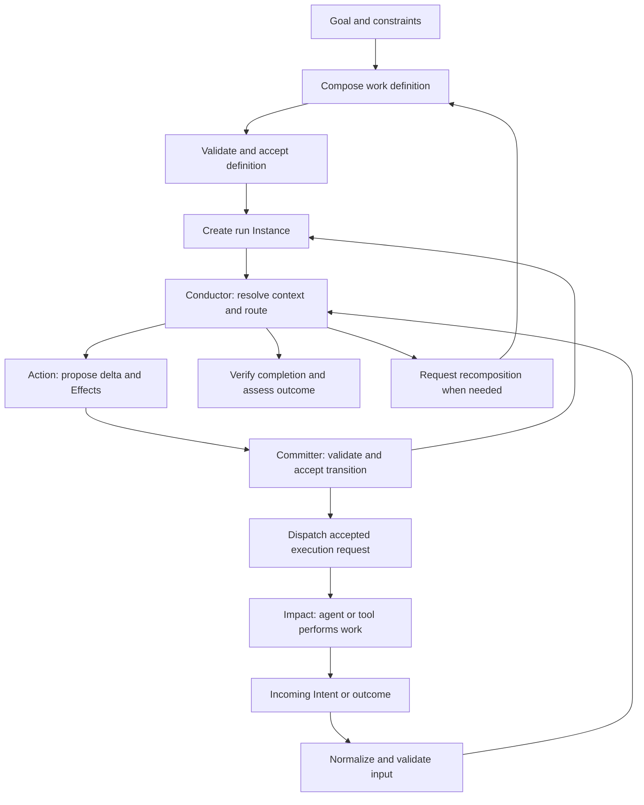

# AXIS for Orchestrations

*Architectural principles for composing and conducting the work of human, AI, and mixed agent systems.*

**Status:** Draft orchestration design guide  
**Date:** 2026-10-08

## 1. Purpose and basis

AXIS applies to agent orchestration wherever intent must become coordinated work and produce an accepted change. Its Essence–Expression distinction separates the structure of possible work from a particular performance of that work. Its responsibility boundaries separate interpreting requests, selecting capabilities, deciding transitions, coordinating execution, and establishing outcomes.

The symphony metaphor makes this structure accessible:

> Composition defines what the work means, how its parts relate, and what constitutes a successful whole. Conducting brings that composition into execution through particular agents, resources, timings, and conditions.

This guide extends [AXIS-Principles.md](AXIS-Principles.md), [AXIS-Specification.md](AXIS-Specification.md), [AXIS-Design.md](AXIS-Design.md), [AXIS-Code.md](AXIS-Code.md), and [AXIS-Lite.md](AXIS-Lite.md). It complements [AXIS for Organizations.md](AXIS%20for%20Organizations.md): that document maps organizational responsibilities; this one defines how work can be composed, assigned, performed, verified, and adapted across agents.

The existing specification explicitly distinguishes the Manager's **Composer** (Binder) from its **Conductor** (Router, Workflow, and Committer). This guide broadens composition to include project and process design, in addition to component binding. That broader interpretation is a proposed application of AXIS, not a change to its canonical software contracts.

The design applies to a single agent with several capabilities as well as many collaborating agents. An orchestration is defined by coordinated responsibilities and state transitions, not by agent count or the use of a particular framework.

## 2. Projects and processes both need composition and conducting

A project emphasizes creating a composition for a bounded goal. A recurring process emphasizes repeatedly conducting a reusable composition. Neither is exclusively one activity.

| Concern | Project | Recurring process |
|---|---|---|
| Composition | Design the deliverables, work structure, capability dependencies, and acceptance conditions for a particular goal | Design the reusable stages, decision rules, handoffs, and exception paths |
| Conducting | Execute and adapt the project through actual assignments, evidence, milestones, and decisions | Execute each process case through actual inputs, assignments, state transitions, and outcomes |
| Evolution | Revise the project plan when conditions or knowledge change | Revise the process definition when repeated cases reveal a better method |
| Completion | Accept the project's deliverables and assess its goal | Accept an individual case; the process definition remains available for later cases |

A project may invoke several processes. A process case may create a temporary subproject. Both can contain reusable subprocesses and exploratory work.

The important distinction is **definition versus run**, with explicit transitions when a running orchestration adopts a revised definition.

## 3. The symphony mapping

| Musical concept | Orchestration concept | Architectural implication |
|---|---|---|
| Musical purpose | Goal, values, and constraints | Local work must contribute to the intended whole |
| Score | Versioned work definition | Define dependencies, allowable variation, and acceptance conditions |
| Movements | Phases or major deliverables | Decompose by meaningful outcomes |
| Parts | Tasks or capability contracts | Make each participant's obligations and interfaces explicit |
| Instrument | Capability supported by skills, knowledge, and tools | Select the means suitable for the required work |
| Musician | Agent assigned to exercise a capability | Identity, competence, and authority are distinct from the part |
| Section | Group of related capabilities or an owned domain | Coordinate locally within explicit boundaries |
| Composer | Work designer and structural composition function | Define and revise what is possible |
| Conductor | Runtime coordination function | Decide what happens now within the accepted composition |
| Performance | A particular project execution or process run | Record actual assignments, attempts, state, and results |
| Listening and rehearsal | Observation, verification, and simulation | Use evidence to assess coherence and improve the design |

The metaphor has limits. Work can change the world irreversibly; agents can discover missing requirements; goals can evolve through authorized decisions. A work definition therefore includes adaptation rules and failure paths, not just an exact sequence to reproduce.

The conductor need not tell every agent how to perform its specialist work. It supplies the contract and context, coordinates dependencies, and accepts outcomes. Specialist methods belong to their capability definitions and execution boundaries.

## 4. Intent becomes work, and work becomes change

The Cognitive Flow of Change provides traceability across orchestration levels:

```text
Values and constraints
  → Goal and outcome measures
  → Project plan or process definition
  → Declared work, relationships, and policies
  → Scoped obligations and task instructions
  → Decision logic and authorized execution
  → Coordinated behavior
  → Evidence of change and assessment of the goal
```

A useful task brief records which goal it serves, what it must produce, why its inputs matter, what it may change, and how acceptance will be decided. Downstream tasks receive accepted artifacts and their provenance rather than relying on another agent's conversational memory.

Feedback travels upward. Results update run state; exceptions can trigger replanning; repeated failures can trigger redesign of the reusable process. A local execution result does not itself authorize changing the goal or overriding its constraints.

## 5. The AXIS grid for orchestration

| Axis | Essence | Expression |
|---|---|---|
| Being | **FORM:** Schemas and invariants for work definitions, runs, tasks, assignments, artifacts, and outcomes | **INSTANCE:** Current records of a particular run, task, assignment, or artifact |
| Identity | **IDENTITY:** Stable references for definitions, runs, tasks, agents, and deliverables | **TOKEN:** Scoped authority, assignment leases, run handles, and references to specific revisions |
| Meaning | **FACET:** Available orchestration and specialist capabilities for a role and lifecycle context | **INTENT:** A normalized request to start, assess, perform, revise, cancel, or verify work |
| Relating | **BOND:** Rules for decomposition, prerequisites, ownership, artifact flow, and participation | **LINK:** Resolved tasks, agents, accepted artifacts, and dependencies in this run |
| Doing | **ACTION:** Pure evaluation that proposes state changes and declares work | **MANAGER:** Boundary-scoped composition, routing, workflow progression, and state acceptance |
| Changing | **EFFECT:** Description of execution to request from an agent, tool, or external boundary | **IMPACT:** Actual model invocation, human assignment delivery, tool use, external operation, and returned outcome |
| Bridging | **WRAPPER:** Request, result, review, and interaction surfaces | **ADAPTER:** Normalization of incoming requests and observations into internal Intents |

These components describe functions and contracts. They need not each become a service, class, agent, or file. Skills, plans, budgets, and knowledge are represented within this model; they do not require additional canonical axes.

### Agent reasoning is execution when invoked

Calling a language model is IO and may produce different results from the same inputs. It therefore belongs in Impact in a software implementation. An Action may declare a planning, drafting, or analysis Effect. The returned proposal then becomes input to subsequent evaluation and acceptance.

Likewise, reading files, consulting external knowledge, asking a human, or using a tool is execution. Supply the resulting observations to pure Actions rather than allowing those Actions to discover dependencies themselves.

An agent can perform multiple architectural roles, but its boundary must preserve these distinctions. Calling the entire agent an “Action” would hide model invocation, tool use, orchestration, and mutable state inside a component that AXIS defines as pure.

## 6. Composition: define the work architecture

The composition function answers: **What work can satisfy this goal, and under what contracts?**

Its output is a versioned work definition containing:

- Goal, constraints, outcome measures, and acceptance authority.
- Deliverables and their acceptance criteria.
- Task kinds and required capabilities.
- Input and output contracts, including artifact provenance.
- Dependencies, decision points, permitted parallelism, and bounded repetition.
- Role, skill, knowledge, tool, and authority requirements.
- Resource limits, deadlines, and scheduling policy.
- Review, exception, recovery, and adaptation rules.
- Boundaries that own the resulting records and decisions.

For a known process, composition may mean selecting a compatible definition and binding its capabilities. For a novel project, it may include decomposition and feasibility analysis. Planning itself can be an orchestrated task with a qualified planner and a defined acceptance contract.

### Work structure is more than a task list

Represent relationships by their meaning:

| Relationship | Meaning |
|---|---|
| Decomposition | This task or deliverable is part of a larger work obligation |
| Prerequisite | This condition must hold before dependent work starts |
| Artifact flow | This output revision supplies a named input |
| Decision branch | This accepted decision selects the next path |
| Resource exclusion | These tasks must not use a constrained resource concurrently |
| Review obligation | This output requires a designated acceptance check |
| Repetition | This work may repeat under a stated condition and limit |
| Cancellation or remedy | This event changes whether related work should continue |

A dependency graph is useful for acyclic work. State machines and guarded loops represent retries, review cycles, and long-running processes. Event-driven work may wait for an external observation without having a fixed next execution time.

Validate the composition before starting: required capabilities exist; inputs can be supplied; ownership is unambiguous; ordinary prerequisites do not form an accidental deadlock; loops have termination or escalation rules; resources and budgets are feasible; deliverables collectively support the goal. Logical feasibility does not guarantee that resources will be available at dispatch time.

## 7. Conducting: coordinate a particular run

The conducting function answers: **Given the accepted definition and current facts, what may happen next?**

A run references its work-definition version and owns its current coordination state. The Conductor resolves dependencies, selects capabilities, assigns agents, accepts state transitions, declares execution, processes results, and determines whether further work is required.



Not every accepted transition dispatches work: a result may merely update a dependency or close a task. Nor does a terminal state always mean success; rejection, cancellation, and exhaustion need explicit dispositions.

### A runtime decision cycle

1. Normalize the request or returned observation and preserve provenance.
2. Resolve the run, current revision, relevant Links, authority, and policy context.
3. Select the applicable Facet and Action.
4. Evaluate the proposed transition and execution requests.
5. Validate Form and Bond invariants against current state; reject or reconcile stale proposals.
6. Accept the transition through the state-owning boundary.
7. Dispatch authorized Effects through Impact, with their execution references and limits.
8. Receive results as follow-up Intents; validate and evaluate them through another cycle.

Manager state acceptance is a logical responsibility. Database writes, queue delivery, and other persistence IO still belong to Impact. A robust implementation also needs a durable connection between accepted execution obligations and actual dispatch, such as an outbox or recoverable journal, so a crash cannot silently lose work or blindly repeat it.

Workflow-control Effects, such as requesting a pause or cancellation, are interpreted by the Conductor as described in AXIS-Code. Any required outward communication or IO remains Impact's responsibility. Workflow operations should not be smuggled into ordinary state fields as magic commands.

## 8. Assign capabilities, then agents

A task definition requires a capability. A role establishes responsibility and contextual authority. An assignment binds a particular qualified agent to the task. A tool supplies an execution mechanism. Keep these distinct so the composition can survive personnel, model, and infrastructure changes.

An agent is eligible only when all relevant conditions hold:

```text
Eligible(agent, task, context) =
    capability match
    AND evidenced skill fit
    AND available and current knowledge
    AND permitted tool and data access
    AND valid scoped authority
    AND compatible capacity and deadline
    AND required independence from conflicting roles
```

Routing first excludes ineligible candidates, then ranks eligible candidates using declared criteria such as quality, latency, cost, continuity, or load. A low price does not compensate for missing authority or a mandatory qualification.

The assignment contract supplies:

- Task and run identities; definition and input revisions.
- Goal contribution, expected output, and acceptance criteria.
- Relevant knowledge, source references, and policy versions.
- Tool permissions and permitted changes.
- Budget, deadline, and bounded autonomy.
- Result destination, acknowledgement requirements, and escalation route.

The receiving agent acknowledges the obligation or returns a structured rejection. Dispatch does not prove acceptance. If the selected agent can delegate, define which work it may delegate, which constraints must propagate, and how the parent remains accountable.

### Knowledge, memory, and context

Treat an agent's conversational memory as a working aid. Authoritative task state, accepted artifacts, policy, and decisions belong to their explicit owners. A replacement agent should be able to resume using those records and a sufficient checkpoint rather than requiring an identical conversation history.

Distinguish instructions from supplied material. Retrieved documents, tool results, and another agent's outputs are evidence or proposals; they do not acquire authority to change the task's scope, permissions, or governing policy merely by being included in context. Adapters preserve that distinction when normalizing them.

## 9. Ownership, hierarchy, and parallelism

Every mutable record has one accepting boundary. Agents propose changes to shared work through that boundary or submit separate artifacts for integration. Parallel workers should not silently overwrite a common plan, task status, or deliverable.

Use distinct references for:

| Reference | Purpose |
|---|---|
| Work-definition identity and version | Which composition governs the work |
| Run identity | Which performance is being coordinated |
| Task identity | Which obligation is being fulfilled |
| Attempt identity | Which particular execution produced a result |
| Artifact identity and revision | Which output or input is being referenced |
| Agent identity and assignment scope | Who performed the work under which authority |

### Nested orchestration

A parent orchestrator may declare a child-work Effect. The child boundary accepts a contract, conducts its own work, and returns its outcome. The parent owns its dependency and integration state; the child owns its internal task state.

Cross-boundary communication follows AXIS's Effect → Impact → receiving Wrapper/Adapter → Intent path. A parent does not directly mutate the child's internal store. Cancellation, scope changes, and deadline changes travel through the same explicit contracts.

Use nested boundaries when domain language, state ownership, decision rules, or lifecycle differ. Do not create another orchestrator merely because a task has another step. Within a boundary, a related capability can use another Action or a workflow subcomponent.

### Parallel work and joins

Define independent work packages with explicit input revisions and output destinations. Specify whether a join needs all results, a designated subset, a quorum, or one accepted result. Define treatment of late results, conflicting findings, and invalidated inputs.

When several agents produce alternative drafts, their completion is not a shared commit. An integration capability evaluates those drafts and proposes the accepted deliverable revision. A majority of agents agreeing is a decision rule only if the composition explicitly permits it; agreement alone is not evidence of correctness.

## 10. Bounded autonomy and adaptation

An agent's autonomy is part of its contract. State which methods it may choose, what resources it may consume, which changes it may perform, whether it may create subtasks, and which conditions require returning to the coordinator.

The Conductor may adapt execution within the accepted rules: select another eligible agent, reschedule independent work, retry a permitted attempt, or request missing evidence. Altering deliverables, dependency structure, authority, resource ceilings, or acceptance rules is recomposition when it exceeds those rules.

An explicit replanning path is:

```text
New evidence or exception
  → Intent requesting plan revision
  → bounded planning execution
  → proposed definition revision and affected-work analysis
  → validation and acceptance by the designated owner
  → explicit migration of the run
  → resumed conducting
```

Preserve the previous definition, the reason for change, and its effect on active work. Decide whether in-flight tasks continue, stop, or submit results for possible reuse. Evaluate accepted outputs whose inputs or criteria changed; do not assume they remain valid.

Avoid unbounded self-expansion. Define limits on decomposition depth, concurrent assignments, model calls, elapsed time, cost, review cycles, and retries as appropriate. Planning and coordination consume resources too. Exhausting a limit produces a visible decision point, not an implicit increase of the limit.

Exploratory work can be bounded by a question, permitted methods, resource limits, and a learning-output contract. Its accepted result may be reduced uncertainty or a justified finding that the current goal is infeasible.

## 11. Evidence, verification, and completion

Separate four propositions:

1. The agent attempted the work.
2. The agent produced an output.
3. The output satisfies its acceptance contract.
4. The accepted output contributed to the intended goal.

Each needs appropriate evidence. A fluent summary is not proof of a file change, successful operation, or correct result. Store artifact references, relevant checks, observed target state, input revisions, and review dispositions. Verification may itself require an Effect and an eligible verifier.

Use deterministic checks where they establish the relevant property, specialist judgment where needed, and independent review where the contract requires it. Record uncertainty and unresolved disagreement rather than turning confidence estimates into facts.

The Conductor closes a task when its acceptance conditions hold, closes a run when its required obligations have an accepted disposition, and reports the goal's outcome using its defined measures. Cancellation and failure can close a run without claiming successful delivery.

## 12. Recovery and continuity

| Condition | Architectural response |
|---|---|
| Missing input or capability | Hold the task with a reason and request the missing dependency or a revised plan |
| Agent declines or becomes unavailable | Reassign within authority and preserve accepted work and provenance |
| Attempt times out | Determine whether work occurred before dispatching another attempt |
| Duplicate result or delivery | Recognize the execution reference and handle the duplicate without repeating accepted consequences |
| Late result from a superseded attempt | Record it; reconcile against the current assignment, input revisions, and lifecycle before acceptance |
| Conflicting parallel proposals | Route to the integration or decision capability; preserve the alternatives |
| Output fails acceptance | Create bounded rework with the findings and changed context |
| Tool produces partial change | Observe actual target state and perform declared reconciliation or compensation |
| Budget, deadline, or iteration limit is reached | Pause, terminate, or escalate according to the accepted policy |
| Coordinator crashes or restarts | Reconstruct coordination state from durable records and reconcile uncertain executions |
| Cancellation arrives during execution | Stop undispatched work, signal active executors, record acknowledgements, and reconcile any completed consequences |

### Leases, checkpoints, and stale work

Long-running assignments may need leases or equivalent ownership rules. A replacement assignment must prevent the earlier worker from authoritatively committing after its scope ends, for example through a checked assignment generation or fencing reference. Revocation cannot itself stop an already-issued external operation; reconcile that operation's actual outcome.

A checkpoint records enough accepted state, pending obligations, input and definition versions, artifact references, and attempt history to continue. Recovery must distinguish undispatched, dispatched, acknowledged, completed, and uncertain work. Durable delivery plus deduplication can support reliable behavior; it does not justify claiming exactly-once execution across arbitrary external systems.

Historical replay reconstructs or evaluates decisions from recorded observations. It must distinguish reconstruction from live execution. Compensation is a new execution obligation and may only remedy part of the original consequence.

## 13. Worked example: compose and conduct a research report

**Goal:** Produce an accepted report answering a defined business question within a stated budget and deadline.

### Project composition

The Composer defines the question, audience, required evidence, deliverable shape, and acceptance conditions. It creates these work packages:

| Part | Capability | Dependencies | Accepted output |
|---|---|---|---|
| Clarify brief | Requirements analysis | Initial request and stakeholder constraints | Accepted question, scope, and criteria |
| Gather evidence A and B | Qualified research | Accepted brief and source requirements | Source-backed findings with provenance |
| Integrate findings | Synthesis | Accepted evidence packages | Draft with supported claims and identified disagreements |
| Check claims | Verification | Draft and cited evidence | Findings on factual support and unresolved issues |
| Revise and accept | Editing and designated acceptance | Draft and verification disposition | Accepted report artifact |

The score permits parallel evidence gathering, requires both accepted packages before synthesis, and allows at most two revision cycles before escalation. Agent requirements, source access, spending limits, and artifact ownership are explicit. Delivery outside the work boundary is a separate Effect if requested by the goal.

### Runtime conducting

1. Intake becomes a normalized Intent to create the project run.
2. The Conductor resolves a compatible definition, creates the run, and declares the clarification assignment.
3. After accepting the brief, it assigns research A and B to eligible agents. Model calls and source retrieval occur through Impact; the workers return artifacts and evidence.
4. Research B reports insufficient accessible evidence. The Conductor records a blocked dependency. A permitted clarification or discovery step may resolve it; otherwise it requests recomposition rather than pretending the join is satisfied.
5. Once both evidence packages are accepted, the synthesis task receives their exact revisions. Its output remains a proposal until evaluated against its contract.
6. Verification identifies an unsupported claim. A revision task receives the finding and sources. Completion of the drafting attempt alone cannot close the project.
7. The designated acceptance capability accepts the final artifact. The run closes with recorded evidence, consumed budget, and any remaining limitations.

### Reusable process

The same work structure can become a report-production process definition. Each new report has a different run identity, question, context, assignments, and evidence. A later project to improve report production composes changes to that process; existing report cases adopt the new version only under an explicit migration rule.

## 14. Reusable orchestration contracts

These are design templates for an AXIS application, not replacement canonical type definitions.

### Composition contract

```text
Work definition identity / version / owner:
Goal, values, constraints, and outcome measures:
Deliverables and acceptance authority:
Task kinds and capability requirements:
Forms, invariants, and relationship rules:
Input/output contracts and artifact flows:
Sequence, branches, parallel joins, and bounded loops:
Roles, qualification, knowledge, and tool requirements:
Authority, budget, deadlines, and capacity policy:
Exception, verification, recovery, and adaptation rules:
Run creation and definition-migration rules:
```

### Runtime coordination contract

```text
Run identity / definition version / current revision:
Coordination owner and policy scope:
Accepted Intents and owned state:
Resolved tasks, agents, dependencies, and artifacts:
Assignment selection and acknowledgement rules:
Readiness, dispatch, and state-acceptance rules:
Execution references, attempts, and leases if needed:
Pending work, observed outcomes, and verification state:
Budget and timing consumption:
Escalation, recomposition, cancellation, and closure rules:
Checkpoint, reconciliation, and restart responsibilities:
```

### Agent work contract

```text
Task / run / attempt / definition and input revisions:
Required capability and expected goal contribution:
Selected agent identity and qualification basis:
Assignment authority and validity:
Inputs, knowledge sources, tools, and context:
Permitted autonomy and changes:
Resource limits, deadline, and delegation limits:
Output schema, artifact destination, and evidence:
Acceptance owner and criteria:
Acknowledgement, result, cancellation, and failure protocol:
```

## 15. Design method and practical adoption

1. Define the goal, constraints, and measurable outcome.
2. Compose deliverables and capability contracts before choosing particular agents.
3. Define owned state, work relationships, and accepted transition rules.
4. Specify authority, qualification, knowledge, resources, and autonomy.
5. Design execution and result contracts, including evidence and verification.
6. Define parallel joins, loops, failures, cancellation, and permitted adaptation.
7. Bind eligible agents and tools; conduct a run with explicit identities and revisions.
8. Assess the accepted deliverables and goal outcome; revise the composition using observed results.

Start with a brief, a work definition, a run record, an assignment contract, and evidence-based acceptance. Add richer Tokens, Facets, relationship models, nested coordinators, or recovery infrastructure when the work needs them. The orchestration should reveal responsibility more clearly than it adds ceremony.

Review its architecture with practical questions:

- Can the composition be understood without reading every agent's prompts?
- Can a specialist or model be replaced while preserving the work contract?
- Can a task start only when its inputs, authority, capacity, and constraints permit it?
- Is every model and tool invocation visible as execution with an owned obligation?
- Can parallel results be integrated without hidden shared mutation?
- Can replanning be distinguished from ordinary scheduling?
- Can a restart, timeout, or cancellation be handled without losing accepted work or blindly repeating consequences?
- Can completion be established from evidence and linked to the original goal?

Measure outcome quality, lead time, blocked time, rework, resource consumption, and coordination overhead. More agent activity is not itself a better performance. The value of orchestration lies in producing coherent, accepted change through responsibilities that can be understood, composed, and conducted.


>
> **Attribution and License**
>
> AXIS, formulated by Matthew Quarneri — MENTIC Cognitive Systems. © 2026 MENTIC LLC. Originally published at [mentic.com/AXIS](https://mentic.com/AXIS).
>
> If you found these ideas useful you could [Buy Me a Coffee](https://buymeacoffee.com/mattq4) to show your support.
> 
> Except where otherwise noted, this document is licensed under the [Creative Commons Attribution 4.0 International License (CC BY 4.0)](https://creativecommons.org/licenses/by/4.0/). Code examples in it may also be used under the [Apache License 2.0](https://www.apache.org/licenses/LICENSE-2.0). See [LICENSE.md](LICENSE.md).
>
> You may share and adapt this material, including for commercial purposes, under the license terms. When sharing the material or adaptations, give appropriate credit to Matthew Quarneri and MENTIC Cognitive Systems, link to the original at [mentic.com/AXIS](https://mentic.com/AXIS), provide a link to the license, and indicate any changes. Attribution must not imply endorsement.
>
> **Support and Advisory Services**
>
> If AXIS contributes substantial commercial value to your organization, please consider supporting its continued development through sponsorship or a paid advisory engagement. Financial support is voluntary and is not a condition of the license. Or just buy M@ a coffee [here](https://www.buymeacoffee.com/mentic).
>
> For sponsorship, workshops, process design, or agent orchestration consulting, contact [consulting@mentic.com](mailto:consulting@mentic.com).
>
> ---
>
> This permits commercial reuse **without mandatory payment**, while requiring attribution under the license. [Official license summary](https://creativecommons.org/licenses/by/4.0/)
>
> For more interesting ideas visit [MENTIC Cognitive Systems](https://www.mentic.com)